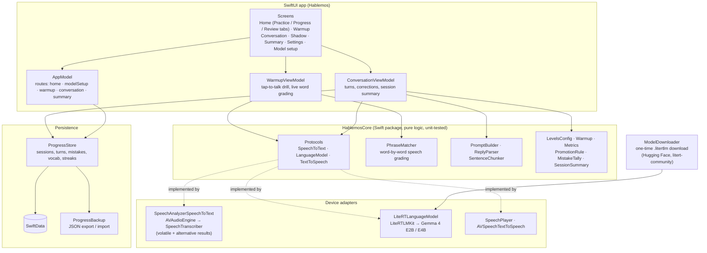
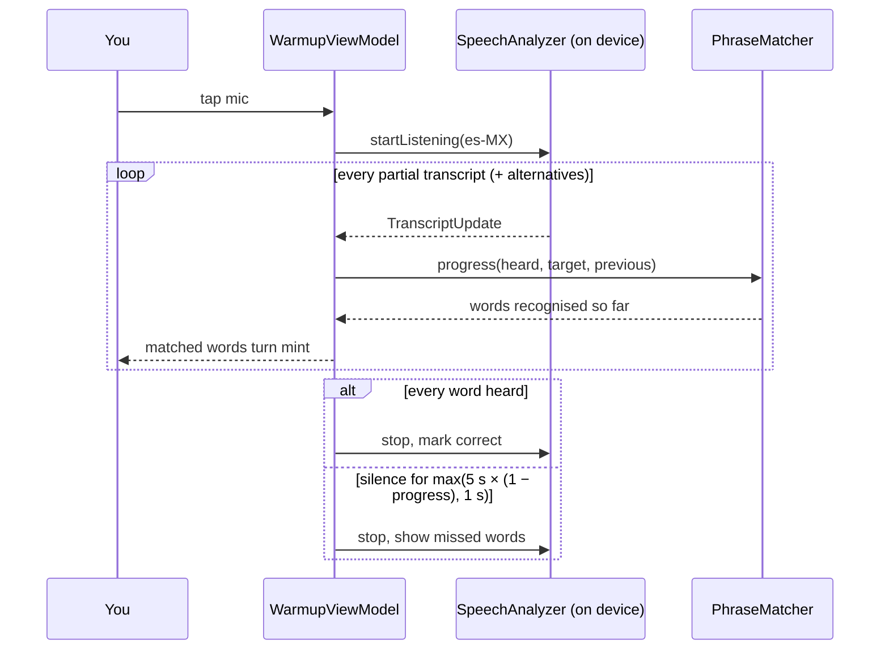

# Hablemos

A personal iOS app for practising spoken Spanish. You warm up on a scenario's key words and
sentences, then hold a spoken conversation with Lucía, an AI tutor. The app corrects your mistakes,
tracks your weak spots, and moves you up CEFR levels (A1–B2) as you improve.

Everything runs on the device: speech recognition uses Apple's `SpeechAnalyzer`, the tutor is a
Gemma 4 model running through LiteRT-LM, and Lucía's voice is `AVSpeechSynthesizer`. No audio or
text leaves the phone. The only network use is the one-time model download.

## Architecture



`HablemosCore` holds all the logic that doesn't touch a device API, behind the three protocols,
so it builds and tests on macOS. The app target plugs in the real speech, model and voice
adapters; tests plug in the mocks from `HablemosCore`.

### How a speaking drill is graded

The warm-up grades speech word by word, an approach borrowed from Duolingo's speak exercises:



A word counts when it matches exactly once case, punctuation and accents are removed. So "esta" is
accepted for "está", but "quiere" is not accepted for "quiero".

## Project layout

| Path | What's there |
|---|---|
| `Hablemos/` | The SwiftUI app: screens, view models, speech, LLM and persistence adapters |
| `HablemosCore/` | Swift package with the pure logic and its unit tests |
| `HablemosTests/` | App-level tests (view models, persistence, model setup) |
| `LiteRTLMKit/` | Vendored Swift wrapper for Google's LiteRT-LM (Apache 2.0) |

## Requirements

- Xcode 26, iOS 26 (needed for `SpeechAnalyzer`)
- About 2.6 GB (E2B) or 3.7 GB (E4B) of free space for the downloaded model

## Running tests

```sh
cd HablemosCore && swift test   # core logic, runs on macOS
```

The app tests in `HablemosTests` need an iOS simulator. Run them from Xcode with the `Hablemos`
scheme.
